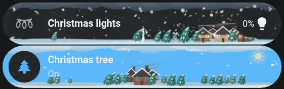
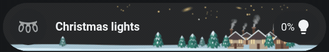
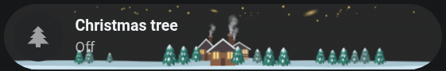

# Christmas Bubble for Home Assistant

Your light switch asked for a Christmas bonus. It got a chalet, seventeen pine trees and a chimney it now has to maintain.

Give a Bubble Card light slider or switch a little Alpine village of its own. Turn on a switch and morning comes to the village. Raise a dimmer above 50% and daylight rolls in. Pines sway in the wind, smoke drifts from the chimneys and snow settles on the roofs.

## Installation

1. Install [Bubble Card](https://github.com/Clooos/Bubble-Card#installation) through HACS.
2. Download [christmas-buttons.zip](https://github.com/bassie661/christmas-bubble/releases/download/v1.0.3/christmas-buttons.zip) and unzip it. Copy `dashboard-christmas-snow.js` into the `www/` folder in your Home Assistant configuration directory. If you just created the folder, restart Home Assistant once.
3. Go to **Settings → Dashboards → ⋮ → Resources**. Add `/local/dashboard-christmas-snow.js?v=1.0.3` and choose **JavaScript module**. If Resources is hidden, turn on Advanced Mode in your profile.
4. Add a **Manual** card to your dashboard. Paste the [light slider example](examples/light-slider.yaml), the [switch example](examples/switch.yaml) or [both cards together](dashboard.yaml). Replace the example light or switch with your own entity ID, save and reload the dashboard.

### Updating an existing village

Replace `dashboard-christmas-snow.js` with the copy from the new zip. Edit the existing resource URL so it reads `v=1.0.3`, keeping any wind setting. In each Christmas card, replace just the `styles:` block with the one from its matching example above. Save and reload. This lets a switch use a slider’s scenery code and keeps your own entity and village settings.

## Make the village yours

Edit your card and open **Christmas scenery**. The preview shows your changes as you go.

- **Trees and chalets** — Plant up to 36 pines and add up to 8 chalets. Set either count to zero to leave them out. Pick a side for your village, choose the size of the houses and decide how closely they huddle together.
- **Shuffle layout** — Try a new arrangement. If you liked the last one better, use the arrows to go back and forth before saving.
- **Scenery code** — Found a keeper? Click the copy icon beside the code to save it somewhere or send it to a friend. Paste it into another card’s **Scenery code** field, select **Apply code** for a preview, then **Save**. The trees, chalets and stars line up across phones and desktops. Each button still controls its own light and weather.
- **Snow and wind** — Let snowstorms and gusts come and go, or turn on **Always snowing** and **Always windy** independently. Neighbouring cards can share a breeze. You can also pick a direction or give one card its own wind.
- **Always night** — Keep the stars out when the lights are on. The icon still shows the device state. Hover over or drag a dimmer to see the daylight and slider fill, or glance at its percentage badge.
- **Icon and badge** — Keep the usual look, or bring the controls in front of the snow with a tinted or solid background.
- **Twilight edge** — On a slider, choose how softly daylight blends into night. Use 0 for a sharp edge and 10 for the softest fade, or link a Number helper to adjust it from your dashboard.

YAML options

Set these keys alongside `entity` in the card YAML.

| Setting | Values |
| --- | --- |
| `christmas_trees`, `christmas_houses` | 0–36 trees and 0–8 chalets. Defaults are 4 trees on a slider, 7 on a switch and 1 chalet. |
| `christmas_house_position` | `left`, `center` (default), `right`, `spread` |
| `christmas_house_size`, `christmas_house_clustering` | `smaller`, `normal`, `bigger` for size. `tight`, `normal`, `loose` for spacing. Both default to `normal`. |
| `christmas_seed`, `christmas_profile` | Layout seed and landscape style (`slider` or `switch`). Applying a scenery code fills these in for you. |
| `christmas_wind` | `shared`, `left`, `right`, `independent`. Omit to follow the dashboard wind. |
| `christmas_always_windy`, `christmas_always_snowing`, `christmas_always_night` | `true` or `false`. All default to `false`. |
| `christmas_controls` | `default`, `tinted`, `solid` |
| `christmas_twilight` | 0–10 (default 6), or a Number helper such as `input_number.christmas_twilight`. Sliders only. |

For YAML-managed dashboard resources, use the installation URL with `type: module`. The dashboard wind defaults to `shared`. To change it, append a parameter such as `&wind=left` to the resource URL.

## Previews

**Shared wind**

**Switch on/off**

Slider previews: dimming and twilight edge

**Star twinkle**

Snowstorm

[Release notes](CHANGELOG.md) · [MIT license](LICENSE.txt)
