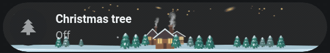
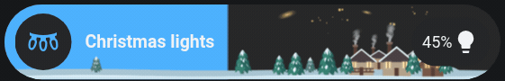

# Christmas Bubble for Home Assistant

Animated winter scenery for Bubble Card light sliders and switches. Sliders change to daylight above 50% brightness. Switches follow the entity’s on/off state. The animation targets 30 fps, pauses offscreen and respects reduced motion.

## Installation

1. Install [Bubble Card](https://github.com/Clooos/Bubble-Card#installation) through HACS.
2. Extract [christmas-buttons.zip](https://github.com/bassie661/christmas-bubble/releases/download/v1.0.2/christmas-buttons.zip). Copy `dashboard-christmas-snow.js` to your Home Assistant configuration directory under `www/`. Restart Home Assistant if you just created that directory.
3. Under **Settings → Dashboards → ⋮ → Resources**, add `/local/dashboard-christmas-snow.js?v=1.0.2` as a **JavaScript module**. Enable Advanced Mode in your profile if Resources is hidden. For YAML-managed resources, use the same URL with `type: module`.
4. Add a Manual card using [examples/light-slider.yaml](examples/light-slider.yaml), [examples/switch.yaml](examples/switch.yaml) or [dashboard.yaml](dashboard.yaml) for both. Replace the example entity IDs, save and reload the dashboard.

## Upgrade from v1.0.0 or v1.0.1

Replace the JavaScript file and set `v=1.0.2` on the existing resource URL. Keep any `wind` parameter. Copy the updated `styles:` block from the matching example into each Christmas button, then reload the dashboard.

## Per-button options

Configure these under **Christmas scenery** in the card editor, or set the YAML keys alongside `entity`.

- **Trees** (`christmas_trees`) — 0–36, including foreground pines. Defaults to 4 on sliders and 7 on switches.
- **Chalets** (`christmas_houses`) — 0–8. Defaults to 1.
- **Chalet placement** (`christmas_house_position`) — `left`, `center` (default), `right` or `spread`. Left and right move the whole village. Spread increases spacing within the village.
- **Chalet size** (`christmas_house_size`) — `smaller`, `normal` (default) or `bigger`.
- **Chalet clustering** (`christmas_house_clustering`) — `tight`, `normal` (default) or `loose`.
- **Shuffle layout** (`christmas_seed`) — Generate a new arrangement. The arrows revisit layouts from this editing session. Saving keeps the selected seed.
- **Wind direction** (`christmas_wind`) — `shared`, `left`, `right` or `independent`. Omit to inherit the dashboard setting. Shared wind changes direction every four minutes.
- **Always windy** (`christmas_always_windy`) — Keep wind blowing between gusts. Default `false`.
- **Always snowing** (`christmas_always_snowing`) — Keep snow falling between storms. Default `false`.
- **Always night** (`christmas_always_night`) — Keep the sky dark and show device state through the icon. Hover or drag a dimmer to reveal daylight and slider fill. Default `false`.
- **Icon and badge** (`christmas_controls`) — `default`, `tinted` or `solid`. Tinted and solid place the controls above the scenery.
- **Twilight edge** (`christmas_twilight`, sliders only) — Slider fill transition width from 0 (sharp) to 10 (widest). Defaults to 6. Also accepts a Number helper such as `input_number.christmas_twilight`.

Set the dashboard wind direction on the resource URL, for example `/local/dashboard-christmas-snow.js?v=1.0.2&wind=left`. The default is `shared`.

## Previews

**Shared wind**

**Switch on/off**

Slider previews: dimming and twilight edge

**Star twinkle**

Snowstorm

[Release notes](CHANGELOG.md) · [MIT license](LICENSE.txt)
