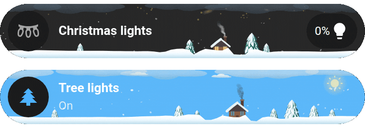
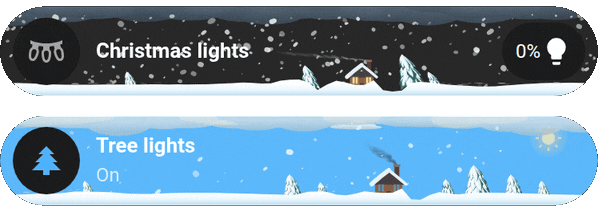
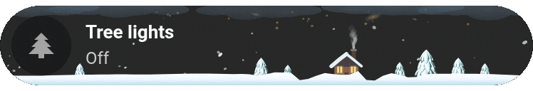
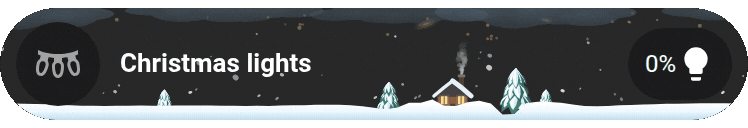
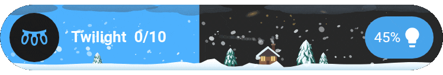
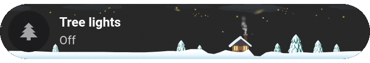
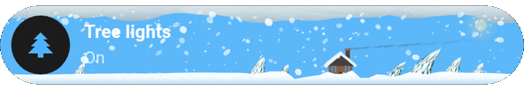

# Christmas Bubble for Home Assistant

By [bassie661](https://github.com/bassie661).

Give any of your dimmable lights or switches a little winter landscape. Start with one Bubble Card button, or add as many as you like. Each one follows its own device. You can link their wind direction so the chimney smoke and snow drift the same way across your dashboard, while clouds, snowfall and gusts come and go independently.

Choose a [light slider](examples/light-slider.yaml) for brightness control or an [on/off button](examples/switch.yaml) for a switch. The slider shows stars across its unlit portion up to 50% brightness and daylight above 50%. A switch has a starry sky when off and sunshine when on.

## Button previews

Light snow falls on two controls in a quiet dashboard scene. The dimmer is off at 0% and the switch is on. [View the daytime button](previews/on.png) or [the nighttime button](previews/off.png) individually.



**Shared wind.** These two controls link only their wind direction. Watch the falling snow and chimney smoke drift the same way while each button has its own gusts and snowfall.



**Switching on.** The stars fade and the sun comes out as the switch turns on.



**Dimming.** Watch the slider settle at 0%, 26% and 62%. The sky changes to daylight as the brightness passes 50%.



**Twilight edge.** The light stays at 45% while the edge of the blue slider changes from sharp (0) to soft (6) to its widest blend (10). [Adjust the twilight edge](#twilight-edge)



**A clear night.** A single star catches the eye for a moment above the cottage.



<details>
<summary>Watch a button in a snowstorm</summary>

A stronger gust bends the trees, pulls the smoke into wisps and drives snow against the cottage.


</details>

## Project files

| File | What you’ll find |
| --- | --- |
| [dashboard.yaml](dashboard.yaml) | Sample dashboard stack containing a slider and a switch. |
| [dashboard-christmas-snow.js](dashboard-christmas-snow.js) | The animation code for the sky, snow, trees and cottages. |
| [examples](examples/) | Standalone YAML for each button type. |
| [previews](previews/) | Individual buttons showing switching, dimming, twinkling and wind. |
| [winter-buttons-en.gif](winter-buttons-en.gif) | The two buttons in motion. |
| [preview.png](preview.png) | A still image of the dashboard buttons. |
| [README.md](README.md#installation) | Installation steps and wind direction settings. |
| [LICENSE.txt](LICENSE.txt) | The MIT license for using and sharing the project. |

## Installation

1. Install **Bubble Card** from HACS and check that a regular Bubble Card works on your dashboard. [Bubble Card installation](https://github.com/Clooos/Bubble-Card#installation)
2. [Download the ZIP](https://github.com/bassie661/christmas-bubble/raw/HEAD/christmas-buttons.zip) and extract it. Copy `dashboard-christmas-snow.js` into `www/` inside your Home Assistant configuration directory. If you create `www/` for the first time, restart Home Assistant once.
3. Under **Settings → Dashboards**, open the three-dot menu and choose **Resources**. Enable Advanced Mode in your user profile if necessary. Add `/local/dashboard-christmas-snow.js` as a **JavaScript module**. For dashboards that manage resources in YAML, add the same URL with `type: module` to your existing Lovelace resources. [Registering dashboard resources](https://contributors.home-assistant.io/frontend/custom-ui/resources/)
4. Edit your dashboard and choose **Add card → Manual**. Paste [light-slider.yaml](examples/light-slider.yaml) or [switch.yaml](examples/switch.yaml). Replace the example’s `entity:` value with your own light or switch, then save and reload.
5. To add another button, repeat step 4 with another entity. If you’d like both examples together, paste [dashboard.yaml](dashboard.yaml) into a single Manual card and change the two entity IDs.

## Twilight edge

The blue fill can fade into the sky as you drag the dimmer. The edge narrows near either end of the track so the fill reaches 0% and 100% cleanly.

In the [light slider YAML](examples/light-slider.yaml), set `christmas_twilight` at the same level as `entity`. Choose **0** for the ordinary sharp edge, **6** for the default, or **10** for the widest blend. Values in between adjust the width.

```yaml
christmas_twilight: 6
```

To adjust the width from Home Assistant, create a **Number** helper under **Settings → Devices & services → Helpers**. Choose **Slider**, set the minimum to **0**, maximum to **10** and step to **1**. Set its value to **6** to start. Then use your helper’s entity ID as the setting in the card.

```yaml
christmas_twilight: input_number.christmas_twilight
```

You can point several dimmers at the same helper or give each one its own setting. If you already have a Christmas Bubble slider, copy the updated `styles:` block from the light slider example into your card as well.

## Wind direction

Buttons using this resource share a wind direction by default. It turns gradually every four minutes. Each button keeps its own gust strength, snowfall, clouds and chimney smoke cycle.

Set `wind` on the existing JavaScript resource URL to choose the wind setting for all your Christmas Bubble buttons. For example, use `/local/dashboard-christmas-snow.js?wind=left` or, if your URL already has a version, `/local/dashboard-christmas-snow.js?v=2&wind=left`. Reload the dashboard after changing the URL.

| Value | Wind direction |
| --- | --- |
| `shared` (default) | All buttons change direction together |
| `left` | Wind blows towards the left |
| `right` | Wind blows towards the right |
| `independent` | Each button chooses its own direction |

## Motion and updates

The animation pauses while the button is out of view or its tab is hidden. The system’s reduced-motion setting displays a still scene. Browsers with canvas worker support render the snow independently of the dashboard.

To update, replace the JavaScript file, change the resource URL to e.g. `/local/dashboard-christmas-snow.js?v=2` and reload. If the buttons appear without scenery after installation, open `/local/dashboard-christmas-snow.js` on your Home Assistant server and check that it serves the JavaScript file.
