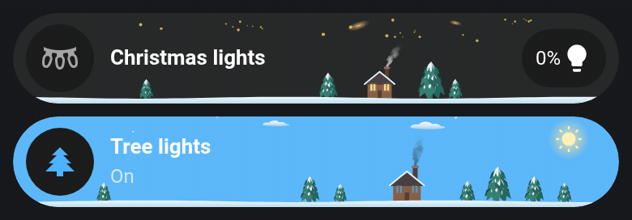

# Christmas Bubble for Home Assistant

By [bassie661](https://github.com/bassie661).

Two animated Bubble Card buttons for a dimmable light and a tree switch. The sky follows each device. Above 50% brightness the light gets a daytime sky. At 50% and below, stars appear over the unlit part of the slider. The tree has daylight when on and stars when off. Clouds, gusts and snowfall vary independently on each button. During a storm, snow blows past the trees. It builds up against the windward wall of a cottage and in the shelter behind it, leaving a shallow hollow just ahead of the wall. Its windows glow at night. Chimney smoke gradually appears and fades, stretching into wisps as the wind picks up.

## Project files

| File | What you’ll find |
| --- | --- |
| [dashboard.yaml](dashboard.yaml) | The two Bubble Card buttons. Change the light and switch entity IDs here. |
| [dashboard-christmas-snow.js](dashboard-christmas-snow.js) | The animation code for the sky, snow, trees and cottages. |
| [preview.gif](preview.gif) | The two buttons in motion. |
| [preview.png](preview.png) | A still image of the dashboard buttons. |
| [README.md](README.md#installation) | Installation steps and wind direction settings. |
| [LICENSE.txt](LICENSE.txt) | The MIT license for using and sharing the project. |

## Installation

1. Install **Bubble Card** from HACS and check that a regular Bubble Card works on your dashboard. [Bubble Card installation](https://github.com/Clooos/Bubble-Card#installation)
2. [Download the ZIP](https://github.com/bassie661/christmas-bubble/raw/HEAD/christmas-buttons.zip) and extract it. Copy `dashboard-christmas-snow.js` into `www/` inside your Home Assistant configuration directory. If you create `www/` for the first time, restart Home Assistant once.
3. Under **Settings → Dashboards**, open the three-dot menu and choose **Resources**. Enable Advanced Mode in your user profile if necessary. Add `/local/dashboard-christmas-snow.js` as a **JavaScript module**. For dashboards that manage resources in YAML, add the same URL with `type: module` to your existing Lovelace resources. [Registering dashboard resources](https://contributors.home-assistant.io/frontend/custom-ui/resources/)
4. Edit your dashboard. Choose **Add card → Manual**, then paste the entire contents of `dashboard.yaml`.
5. Change `light.christmas_lights` to your dimmable light and `switch.christmas_tree` to your tree switch. Each ID appears once. Save and reload the dashboard.

Drag the light slider to dim the lights. Tap the tree button to toggle it. The percentage comes directly from the light's brightness attribute. Each button controls its own entity and also responds to changes made by your existing automations.

## Wind direction

Both buttons share a wind direction by default. It turns gradually every four minutes. Each button keeps its own gust strength, snowfall, clouds and chimney smoke cycle.

Set `wind` on the existing JavaScript resource URL to choose a direction for both buttons. For example, use `/local/dashboard-christmas-snow.js?wind=left` or, if your URL already has a version, `/local/dashboard-christmas-snow.js?v=2&wind=left`. Reload the dashboard after changing the URL.

| Value | Wind direction |
| --- | --- |
| `shared` (default) | Both change direction together |
| `left` | Both blow towards the left |
| `right` | Both blow towards the right |
| `independent` | Each button chooses its own direction |

## Motion and updates

The animation pauses while the button is out of view or its tab is hidden. The system’s reduced-motion setting displays a still scene. Browsers with canvas worker support render the snow independently of the dashboard.

To update, replace the JavaScript file, change the resource URL to e.g. `/local/dashboard-christmas-snow.js?v=2` and reload. If the buttons appear without scenery after installation, open `/local/dashboard-christmas-snow.js` on your Home Assistant server and check that it serves the JavaScript file.
