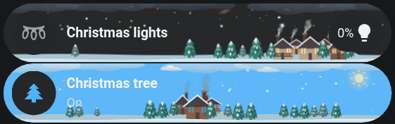
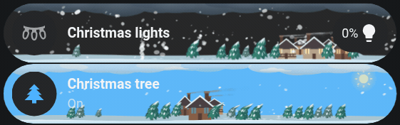
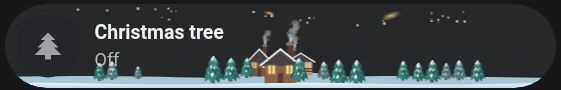
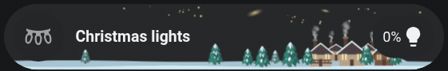
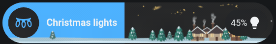
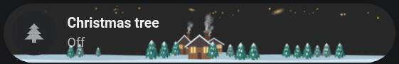
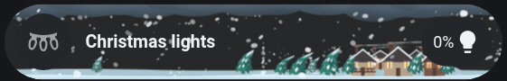

# Christmas Bubble for Home Assistant

By [bassie661](https://github.com/bassie661).

Give any of your dimmable lights or switches a little winter landscape. Start with one Bubble Card button, or add as many as you like. Each one follows its own device. You can link their wind direction so the chimney smoke and snow drift the same way across your dashboard, while clouds, snowfall and gusts come and go independently.

Choose a [light slider](examples/light-slider.yaml) for brightness control or an [on/off button](examples/switch.yaml) for a switch. The slider shows stars across its unlit portion up to 50% brightness and daylight above 50%. A switch has a starry sky when off and sunshine when on.

## New in v1.0.2

Open **Christmas scenery** in the visual card editor to arrange your village, shuffle and revisit layouts, choose permanent snow or wind, and set how the icon and badge appear. [Release notes](CHANGELOG.md#v102)

## Button previews

These six-second previews run at 30 frames per second, the same target as the dashboard animation. Light snow falls across both controls in the first clip. The dimmer is off at 0% and the switch is on. [View the daytime button](previews/on.png) or [the nighttime button](previews/off.png) individually.



**Shared wind.** These two controls link only their wind direction. Watch the falling snow and chimney smoke drift the same way while each button has its own gusts and snowfall.



**Switching on.** The stars fade and the sun comes out as the switch turns on.



**Dimming.** Watch the slider settle at 0%, 26% and 62%. The sky changes to daylight as the brightness passes 50%.



**Twilight edge.** The light stays at 45% while the edge of the blue slider changes from sharp (0) to soft (6) to its widest blend (10). [Adjust the twilight edge](#twilight-edge)



**A clear night.** A single star catches the eye for a moment above the cottage.



<details>
<summary>Watch a button in a snowstorm</summary>

A stronger gust bends the trees, pulls the smoke into wisps and drives snow against the cottage.


</details>

## Project files

| File | What you’ll find |
| --- | --- |
| [dashboard.yaml](dashboard.yaml) | Sample dashboard stack containing a slider and a switch. |
| [dashboard-christmas-snow.js](dashboard-christmas-snow.js) | The animation code for the sky, snow, trees and cottages. |
| [examples](examples/) | Standalone YAML for each button type. |
| [previews](previews/) | Animated previews of switching, dimming, twinkling and wind. |
| [winter-buttons-en-v1.0.2.gif](winter-buttons-en-v1.0.2.gif) | The two buttons in motion. |
| [preview.png](preview.png) | A still image of the dashboard buttons. |
| [README.md](README.md#installation) | Installation steps and wind direction settings. |
| [README.txt](README.txt) | Plain-text installation, upgrade and configuration guide. |
| [CHANGELOG.md](CHANGELOG.md) | Release notes. |
| [LICENSE.txt](LICENSE.txt) | The MIT license for using and sharing the project. |

## Installation

1. Install **Bubble Card** from HACS and check that a regular Bubble Card works on your dashboard. [Bubble Card installation](https://github.com/Clooos/Bubble-Card#installation)
2. [Download the ZIP](https://github.com/bassie661/christmas-bubble/releases/download/v1.0.2/christmas-buttons.zip) and extract it. Copy `dashboard-christmas-snow.js` into `www/` inside your Home Assistant configuration directory. If you create `www/` for the first time, restart Home Assistant once.
3. Under **Settings → Dashboards**, open the three-dot menu and choose **Resources**. Enable Advanced Mode in your user profile if necessary. Add `/local/dashboard-christmas-snow.js?v=1.0.2` as a **JavaScript module**. For dashboards that manage resources in YAML, add the same URL with `type: module` to your existing Lovelace resources. [Registering dashboard resources](https://contributors.home-assistant.io/frontend/custom-ui/resources/)
4. Edit your dashboard and choose **Add card → Manual**. Paste [light-slider.yaml](examples/light-slider.yaml) or [switch.yaml](examples/switch.yaml). Replace the example’s `entity:` value with your own light or switch, then save and reload.
5. To add another button, repeat step 4 with another entity. If you’d like both examples together, paste [dashboard.yaml](dashboard.yaml) into a single Manual card and change the two entity IDs.

## Twilight edge

The blue fill can fade into the sky as you drag the dimmer. The edge narrows near either end of the track so the fill reaches 0% and 100% cleanly.

In the [light slider YAML](examples/light-slider.yaml), set `christmas_twilight` at the same level as `entity`. Choose **0** for the ordinary sharp edge, **6** for the default, or **10** for the widest blend. Values in between adjust the width.

```yaml
christmas_twilight: 6
```

To adjust the width from Home Assistant, create a **Number** helper under **Settings → Devices & services → Helpers**. Choose **Slider**, set the minimum to **0**, maximum to **10** and step to **1**. Set its value to **6** to start. Then use your helper’s entity ID as the setting in the card.

```yaml
christmas_twilight: input_number.christmas_twilight
```

You can point several dimmers at the same helper or give each one its own setting. If you already have a Christmas Bubble slider, copy the updated `styles:` block from the light slider example into your card as well.

## Visual card editor

Open **Christmas scenery** in the visual editor of a Christmas Bubble button. Choose tree and chalet counts, chalet placement and size, wind direction, lighting and weather. Sliders also offer a twilight width or an optional Number helper. **Scenery settings help** explains each option in English. Just above it, **About Christmas Bubble Cards** shows the installed version and expands to show a link to the project on GitHub.

Use **Shuffle layout** as often as you like while watching the preview. Use the left and right arrows to revisit layouts from this editing session, including the starting layout. Shuffling again adds a new layout to the end. **Save** keeps the seed of the selected scene. **Cancel** discards the edits. To reproduce a saved village on another button of the same type, use the same tree count, chalet count and layout seed. The equivalent YAML keys are `christmas_seed` and `christmas_wind`. Omit the wind key to use the dashboard resource setting.

**Chalet placement** moves the whole village to the left, center or right. Left and Right keep every roof in the selected outer third of the button. The chalets sit close together in staggered rows, with smaller, more distant roofs visible behind their neighbors. Spread gives them a little more space within the same village. **Chalet clustering** offers Tight, Normal (default) and Loose. It changes the distance between neighbors within the chosen part of the button. **Chalet size** offers Smaller, Normal and Bigger. Bigger adds up to 10% where there is room. The defaults are Center and Normal.

**Icon and badge appearance** applies to the main icon and the percentage badge where present. Choose Default for the usual styling, Tinted foreground to see a little scenery through the controls, or Solid foreground for an opaque background.

**Always night** keeps the scene dark and uses the icon to show whether the device is on. On a dimmer, hover or drag to reveal daylight and the slider fill. Release the slider to return to night. The percentage badge stays visible.

**Always snowing** keeps snow falling between storms. **Always windy** keeps the wind blowing between gusts in the selected direction. Both switches default to off and work independently of each other and of Always night.

```yaml
christmas_house_position: spread  # left, center, right, spread
christmas_house_clustering: tight # tight, normal, loose
christmas_house_size: bigger      # smaller, normal, bigger
christmas_controls: solid          # default, tinted, solid
christmas_always_night: true
christmas_always_snowing: true
christmas_always_windy: true
```

## Trees and chalets per button

Set the counts alongside `entity` on each button. The example below draws a grove of 16 pines and a village of three chalets.

```yaml
christmas_trees: 16
christmas_houses: 3
```

Choose 0–36 trees and 0–8 houses. Zero hides that part of the scenery. Omitting the settings gives the slider four trees and the switch seven, each with one chalet. Extra saplings fill the existing groves. The largest chalet anchors the village, with smaller chalets on either side. Their roofs, timber finishes, balconies and window light vary. Groves leave space for individual crowns beside the village. Small foreground pines stand at chalet corners and count toward `christmas_trees`. The choice holds through light changes and resizing. With a saved layout seed, reloading restores the same arrangement. Without a seed, corner pines are chosen when the card loads.

Snowflakes can pass in front of and behind the village, settle on roofs and branches, or drift against a wall.

For an existing card, copy the updated `styles:` block from the matching example so it passes the counts to the animation.

## Wind direction

Buttons using this resource share a wind direction by default. It turns gradually every four minutes. Each button keeps its own gust strength, snowfall, clouds and chimney smoke cycle.

Set `wind` on the existing JavaScript resource URL to choose the wind setting for all your Christmas Bubble buttons. For example, use `/local/dashboard-christmas-snow.js?wind=left` or, if your URL already has a version, `/local/dashboard-christmas-snow.js?v=2&wind=left`. Reload the dashboard after changing the URL.

| Value | Wind direction |
| --- | --- |
| `shared` (default) | All buttons change direction together |
| `left` | Wind blows towards the left |
| `right` | Wind blows towards the right |
| `independent` | Each button chooses its own direction |

## Motion and updates

The animation pauses while the button is out of view or its tab is hidden. The system’s reduced-motion setting displays a still scene. Browsers with canvas worker support render the snow independently of the dashboard.

To upgrade from v1.0.0 or v1.0.1, replace the JavaScript file and update the existing resource URL to `/local/dashboard-christmas-snow.js?v=1.0.2`. Keep your `wind` setting if you use one, for example `?v=1.0.2&wind=left`. Copy the matching example’s updated `styles:` block into each Christmas button to connect its editor settings to the scenery, then reload the dashboard. If the buttons appear without scenery after installation, open `/local/dashboard-christmas-snow.js` on your Home Assistant server and check that it serves the JavaScript file.
